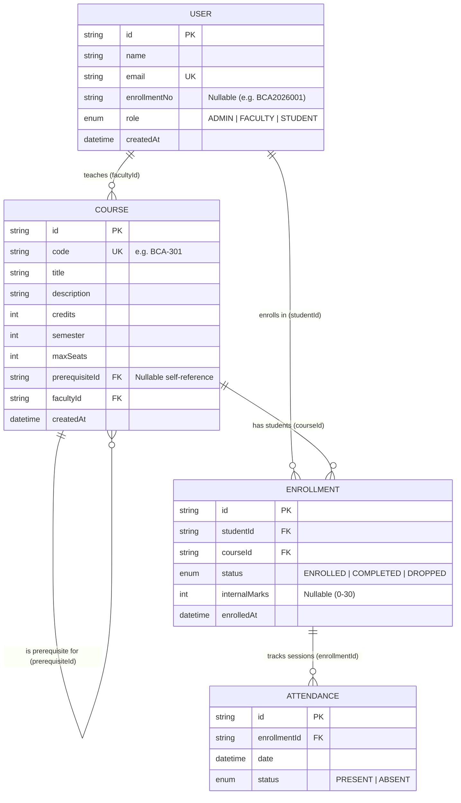
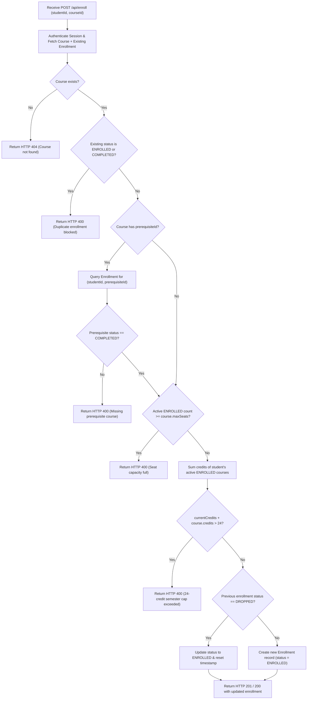

# UniTrack CMS — Software Engineering Architecture & Diagrams

## 1. Normalized 3NF Entity-Relationship Diagram

The database schema strictly enforces Third Normal Form (3NF) across four core entities: `USER`, `COURSE`, `ENROLLMENT`, and `ATTENDANCE`. A self-referencing relationship on `COURSE` models prerequisite dependencies, while composite unique constraints prevent duplicate enrollments and duplicate attendance entries for the same session date.

---

## 2. CBCS Enrollment Validation Algorithm (`POST /api/enroll`)

Before committing a student enrollment record, the API executes four sequential server-side integrity checks inside a transactional workflow. Any rule violation aborts the operation with HTTP `400 Bad Request` and a descriptive diagnostic message.

---

## 3. Attendance Threshold & Safe Deletion Rules

- **Attendance Calculation:** For any enrollment with `totalSessions > 0`, percentage is computed dynamically as `Math.round((presentSessions / totalSessions) * 100)`. Values strictly below `75%` raise a critical academic warning flag across Student and Faculty dashboards.
- **Safe Course Deletion (`DELETE /api/courses/[id]`):** Queries active enrollments where `status === 'ENROLLED'`. If count > `0`, deletion is rejected with HTTP `400` to protect student academic records.
